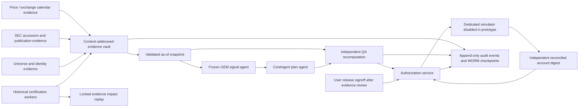
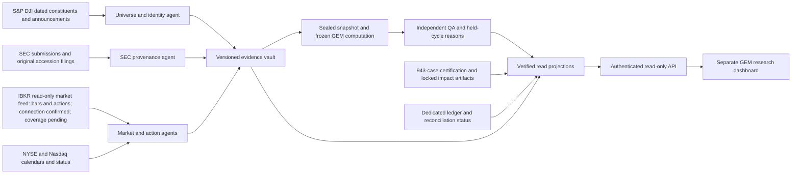

# Architecture: isolated evidence first

## Boundaries and current implementation

The selected hosting stack is **new isolated GEM services on Render and a separate GEM database on Neon**. [HOSTING_AND_EXECUTION.md](HOSTING_AND_EXECUTION.md) makes the gateway/authentication, cloud data flow and simulated-position persistence explicit. The current local dashboard layout is not a deployed Render service. The chat IBKR connector is a sample probe; it cannot be treated as an unattended Render credential. No database, gateway, cloud service or execution is provisioned here.

This repository change is an offline safety prototype. A's `gem_paper` modules do not import `app`, read deployment environment variables or connect to a provider. B reads pinned research artifacts and writes only its own outputs. Neither can submit an order. The production design below is a contract and staged roadmap, not a claim that services are deployed.

Use a separate GEM research account ID, database, object store, worker queue and credentials; no production tables, service routes, account IDs, resets, scanners or scheduled paper jobs may be reused. Network policy denies broker hosts and production database addresses. Future paper execution uses only a dedicated internal simulator capability with no real-money API route or credential. Environments are `unit-fixture`, `offline-research`, `shadow`, `dry-run`, and eventually `paper-approved`; missing/unknown environment is closed.

## Pipeline and state machine

[SOURCES_AND_COLLECTION.md](SOURCES_AND_COLLECTION.md) names the collecting agent, upstream provider/routes, cadence, current access state and acceptance blockers for every evidence type. [DASHBOARD.md](DASHBOARD.md) specifies a separate, read-only research interface and authenticated projection service. The dashboard consumes verified evidence/status and has no order or approval capability. Original Yahoo inputs remain baseline evidence; an account/broker market-data adapter cannot silently change the frozen price/volume/adjustment semantics.

The new source/dashboard diagram is the target design: S&P access, scheduled IBKR collection, API and dashboard are not running. Daily completed-session collection plus a separate monthly rebalance-opening window is the proposed cadence; continuous polling is optional, as detailed in HOSTING_AND_EXECUTION.md. A read-only IBKR sample probe has succeeded; the chosen connection was confirmed by the user and full source qualification remains pending. The planned independent paper capital is USD10,000. The original pipeline's future authorization path stays fail-closed; no dashboard interaction unlocks it.

Run ID = hash of strategy manifest + account + signal session + cutoff policy + immutable input manifest. Separate `attempt_id` for retries. States: `CREATED → COLLECTING → SNAPSHOT_SEALED → SIGNAL_COMPUTED → PLAN_SEALED → QA_PASS → RELEASE_ELIGIBLE → AUTHORIZED → SIMULATED → RECONCILED`. Any uncertainty leads to `HELD` with reason codes; an integrity incident leads to `QUARANTINED`. No timeout or retry can advance a hold. Prototype never advances to `AUTHORIZED`/`SIMULATED`.

1. Collect effective-date universe, exchange calendar, security aliases, price/action history and accession-specific SEC sources into a versioned vault. Validate raw response hash against actual bytes, URL, source entity, request/retrieval time, API status and content type. No URL-only proof.
2. Normalize without overwriting. Link each metric to explicit raw facts, concept mappings, contexts, units and derivations. Reject ambiguity rather than adopt whichever number makes a gate pass. Retain false and unknown dispositions for every member.
3. Seal input manifest at decision cutoff. Sign/hash universe digest, ordered member IDs, close session/time, data rows and adjustment version. Fundamental cutoff is the end of the prior local calendar day plus frozen official filing-date condition, with forward observation no later than decision cutoff. Reject missing competitors even if chosen stocks are individually verified.
4. Compute frozen V1 targets with a pure, version-pinned decision function. Preserve every candidate's price gates, six input uses (or explicit missing dependencies), growth/margin values, r63, stable order, rank, exclusions and reason codes. Only whitelisted contemporaneous fields enter that function.
5. Build a contingent plan at signal time. Bind to account state digest, expected next session and exact cost/sizing rule. At an observed execution open, generate a separate execution-plan version; quotes acquired later must not enter the signal snapshot.
6. QA obtains raw immutable inputs independently of the signal agent's derived metrics. It recomputes the universe, facts, gates, ordering and plan. A distinct authenticated reviewer signs a certificate tied to **all** hashes, exact account, environment, decision session, expiry and allowed actions. Model text or self-declared `PASS` is never a service credential.
7. Future authorization requires user release, QA certificate, approved release/code digest, current reconciliation, healthy vault/ledger, no active incident/kill switch, approved execution window and unused nonce. Any changed input, plan, account state, code, action or evidence invalidates approval. The shipped function always denies.
8. Future local simulator journals order intent and reserves cash/shares before simulating; partial fills or faults remain observable. Apply only committed execution events, rebuild projections and independently reconcile before any further action.

## Evidence contracts

Use canonical JSON, strict enums, UTC ISO timestamps with timezone offsets, finite numeric values, deterministic IDs and schema versions. Preserve the original source timestamp text and stated timezone separately. Required envelopes:

| Artifact | Required content |
| --- | --- |
| Rule manifest | Full base SHA, frozen source/config/spec digests, parameters, rule version, implementation digest, runtime/dependency lock, reviewer |
| Universe | Stable security/share-class/issuer IDs, historical tickers and valid intervals, membership effective-from/to, primary announcement URL+bytes hash+publication time, calendar digest, coverage disposition |
| Price | Security ID, session, raw/vendor/nominal OHLCV, close completion time, observation time, source bytes/hash, adjustment chain, split/dividend/spinoff lineage, coverage gaps |
| SEC fact | CIK, accession, form, official filing date, acceptance and public availability proof, source timezone, raw header/index/submission/XBRL hashes, original context, concept mapping, units/scaling, period start/end, value, derivation dependencies |
| Signal | Account, as-of/cutoffs, source manifest hash, ordered universe hash, every candidate's gates/rank/reasons, canonical top-five targets, missing competitors, full computation/code digest |
| Plan | Signal digest, pre-state digest, expected next session, contingent sizing formula or execution-observed quantities, sell-before-buy order, costs/cash limits, plan digest |
| QA | Reviewer identity, role separation evidence, per-check results, raw evidence hashes, independent output digest, signal+plan+state+release hashes, expiry, signature, unresolved exceptions |
| User release | Explicit signed/recorded user approval reference after evidence review, exact release/evidence hash, paper-only account/environment, effective/expiry time, limits, revocation generation; initially absent |
| Execution/reconciliation | Order idempotency key, account/run/plan, sequence, intent/ack/fill/fault timestamps, qty/price/cost, cash/share/basis/dividend/action postings, independent NAV and residual, checkpoint digest |

SEC companyfacts may help locate matching accessions but cannot alone prove source context or availability. The SEC describes cross-submission aggregation and variable processing delays in [its API documentation](https://www.sec.gov/search-filings/edgar-application-programming-interfaces). Require original accession material; distinguish EDGAR acceptance from confirmed public dissemination and forward first observation. [SEC's FAQ](https://www.sec.gov/files/about/webmaster-faq.htm) documents separate header date fields. Historical evidence fetched today is usable only when the exact original fact and publication can be established; retrieval today cannot prove that a system observed it then.

## Ledger, retries and concurrency

The local implementation uses a hash chain, serialization lock, durable flush/fsync and deterministic event keys. A retry with identical key/payload returns the old event; a different payload with the same key fails. Trusted checkpoints detect rollback; without an external checkpoint a file owner can rewrite a valid chain. This is deliberately described as tamper evidence, not immutable storage.

Purchase-capable release requires separate writer/auditor identities, create-only/WORM retention, off-host checkpoints, signed daily roots, restore verification and access logging. A database unique constraint on `(account_id, run_id, plan_hash, order_index)` plus transactional intent/reservation/outbox prevents duplicate submission. A single fenced lease owns an account. Reconcile simulator status by the same key before retrying an ambiguous acknowledgement; never mint a new order ID. Ledger append failure, checkpoint failure or inconsistent state halts execution. Correct errors with reversing/compensating events, never edits.

Acquisition retries: bounded 3 attempts, exponential jittered delays capped at 30 seconds, explicit rate-limit/retry-after handling and global SEC rate limiter; a failed cutoff deadline creates a hold. Validation, digest, authorization and idempotency conflicts are not retryable. Dead-letter unresolved jobs with owner/reason/review deadline. Prior attempts stay in the audit. No automatic catch-up purchase after the next-open window.

## Parallel B boundary

B cases have frozen IDs `(base SHA, security identity, signal date)` and triage from the pinned 943 rows. Priority depends on contemporaneous momentum versus the fifth candidate, unknown-price risk, shared accession leverage and identity/timing blockers, never subsequent returns. Two separate certifiers agree on fact semantics and timestamp proof; disagreements stay open. Corrections become a new immutable evidence version, with original retained. A consumes only reviewed evidence applicable to its own cutoff; historical results cannot authorize A.

After certifying inputs, replay only the unchanged GEM engine on original and corrected inputs, with exactly matched accounts/dates/costs/benchmarks. Report candidate displacement, month-level target changes, chained holdings/cash effects, NAV/return/drawdown/turnover deltas and unresolved uncertainty. Until price/actions and path-dependent accounting are complete, displacement counts and conditional bounds are appropriate; a numeric return delta is not.
