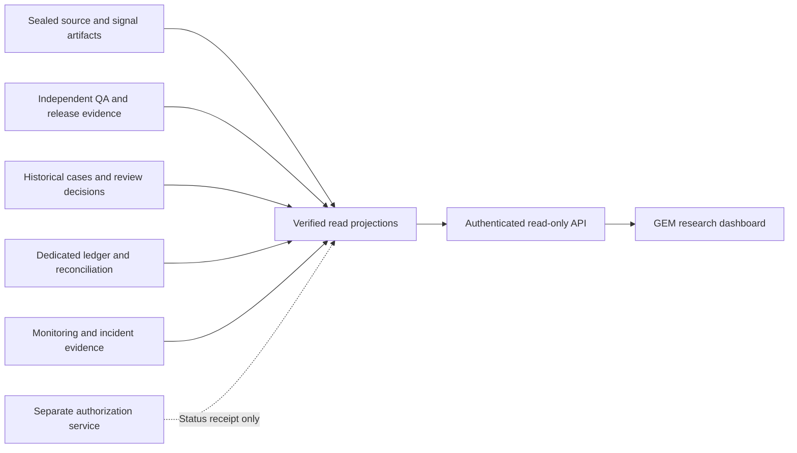

# GEM research review dashboard

Status: proposed read-only dashboard layout, 2026-10-12; IBKR confirmed and local interactive preview prepared; selected connection confirmed; deployed interface and continuous data qualification pending. No route, public site, deployment, API, collector, approval endpoint or account connection is added. It is separate from the existing Trading Radar dashboard and deployed paper strategy. Current facts are development evidence: 23 forward + 27 historical offline tests, 943 open cases, zero complete historical certifications, prospective trial not started. Planned capital is USD 10,000 with a separate cash-only initialization assumption. Committed NAV/cash/holdings and forward performance are unavailable; the portfolio is not initialized and absence is not zero.

## Layout and navigation

Header: `ISK / GEM Research`, exact frozen release reference, experiment/environment, evidence-as-of and display-updated time. Persistent status: **Research only · purchases disabled · forward trial not started**. Navigation: Overview, Sources, Signals & QA, Paper ledger, Historical cases, Audit & incidents. Mobile navigation wraps and the overview's A/B columns stack; no tiny text or hidden safety status.

| Screen | Main content | Review interaction |
| --- | --- | --- |
| Overview | Separate A and B progress; current release gate and named blockers; no implied live market health; incident/coverage work needing attention | Open source gap, QA dossier or historical queue; no start/buy/approve button |
| Sources | Collector agent → exact provider/endpoint → required artifact; access state, historical interval, coverage, last completed observation, expected cadence/deadline, source hash link and failure owner | Inspect original bytes/context/time evidence and retained failed attempts; labels distinguish proposed feed from historical sample |
| Signals & QA | Latest genuinely forward sealed decision, if present; complete universe coverage, every candidate's pass/fail/unknown, all operands and ranks, selected five/cash slots; Q01–Q18 independent status and evidence | Expand a candidate/QA check into accession/context/calendar/action proof; unknown cannot appear as failed/ineligible; no forward signal is displayed before one exists |
| Paper ledger | Only the dedicated GEM account's committed simulator events, reconciled cash/shares/basis/fees/distributions/NAV; contingent/dry-run previews separately labeled | Read intents/receipts, duplicate/uncertain/partial outcomes and reconciliation residuals; never display a preview as a fill or a model budget as actual cash |
| Historical cases | Exact stable 943-case queue with dates, risk bands, missing proof, certifier agreement and case-state history; 137 above cutoff, 147 unknown momentum, 3 cash-slot, 656 below cutoff | Inspect original evidence, corrections, unresolved fields and independent reviews; conditional 29/92 changed-slot sums carry assumptions and are not actual displacements/P&L |
| Audit & incidents | Trusted checkpoint status, source/handoff receipts, append-only events, crash/retry evidence, restore drills, incidents and release dossier | Inspect/export authorized evidence through a future audited read service; no editing ledger/history, auto-clearing holds or release toggles |

UI requirements for later delivery: filter cases by date/state/risk/owner; search by security/case/accession; accessible drill-down; complete denominators and pagination. These are read-only queries. The initial preview uses compact summary tabs and a few verified sample rows; it does not pretend to contain a deployed full queue or authentication system.

## Read architecture and API contract — future implementation

Render hosts the new GEM web/API and worker roles; an isolated Neon database holds durable GEM state and projections. [HOSTING_AND_EXECUTION.md](HOSTING_AND_EXECUTION.md) describes how a supported IBKR data-only gateway/bridge supplies Render and how a future internal simulator records virtual positions in Neon. The local preview is not cloud hosting, and the chat connector is not a server credential.

Proposed GET resources: `/gem-research/overview`, `/sources`, `/signals/{run}`, `/qa/{certificate}`, `/cases?cursor=...`, `/cases/{id}`, `/ledger?account=...&cursor=...`, `/reconciliation/{run}`, `/incidents`, `/evidence/{digest}`. These routes are documentation only. Every response carries schema, experiment/account/environment, evidence-as-of, projection-computed-at, freshness/coverage state, provenance digest and exact source-release revision. Database row counts and retries are not new decisions.

The future projection builder verifies manifests/certificate binding and reads distinct GEM storage with least privilege. Its API cannot create orders, write case decisions, sign QA, clear incidents, mutate accounts or grant release capability. A later user-release workflow must remain an authenticated, separately audited action; this mock contains none. Browser state, a green badge, a toggled tab or a cached `PASS` never authorizes execution. A stale projection displays STALE/UNKNOWN and does not replace an authorization service check.

The browser receives no source API key, broker/production credential, private account identity or unentitled raw vendor redistribution. Evidence links require server-side authorization and source retention/display rights. Encode external text, reject unsafe links, use scoped security IDs, and avoid source instructions executing as UI content. Hashes/technical context can sit in drill-downs; the main interface speaks in sources, evidence, holds and completed reviews.

## Current preview data and safety

- Snapshot labeled 2026-10-11 development evidence. A's forward trial, shadow duration, real month-end rehearsal, QA release and portfolio are not started/unavailable.
- B's counts and the NEM/LLY/AWK samples come from the published historical report; all full cases remain open. SEC has retained historical evidence, not a continuously running certified prospective feed.
- IBKR is confirmed; a market-data-only SPY probe returned 250 daily bars and a snapshot labeled REALTIME, and the user confirmed that this connection supplies the Swedish ISK source; full-universe/session/volume/adjustment qualification is pending. No account balances or holdings were fetched. S&P licensing is unconfigured and no Yahoo/Massive forward collector is selected. NYSE/Nasdaq calendar/status integration is unconnected. No green feed-health claim is manufactured.
- No fabricated NAV/return chart, pending purchase, portfolio balance, actual account, approval signature or incident-resolution record.
- Interactions change local display tabs/details only, without network calls, schedules, external messages, real-money routes or simulated account mutation.

## Acceptance checks

Verify all six screens at desktop and 320px/360px widths, keyboard access, wrapping and visible safety labels. Confirm source drill-down reflects actual status, future timestamp/coverage gaps are not hidden, every displayed historical denominator equals 943 and full certifications stay 0 until reviewed decisions exist. Unknown is distinct from zero, historical is distinct from forward, and previews are distinct from committed fills. Confirm no external requests, secrets, write routes or click path to signoff/orders. Later implemented read services require authenticated scope, XSS/unsafe-link tests, pagination/coverage, projection replay integrity, stale-data behavior and audit/retention entitlement checks before deployment. Existing production dashboard files must remain untouched.

Layout verification is separate from pre-trade QA. Source/register additions and preview remain development design evidence; the prior 50 offline tests do not certify these new services or user release.

## Local preview verification — 2026-10-12

The local layout is reviewed separately from the strategy controls. Root browser checks cover six screens at 320/360/736/1024px, light/dark appearance, visible-panel state, keyboard navigation and absence of approval/buy/form controls. No new UI is installed into `app/`, connected to an account, hosted or deployed. The broker sample proves only market-data access through the named IBKR connection; the user separately confirmed its intended Swedish ISK mapping, without any live-account identity or balance query. The independent QA agent's follow-up review could not complete because its usage allowance was exhausted. New source/dashboard additions remain pending independent QA; the existing 50 offline strategy/research tests are prior evidence and do not certify these designs or qualify a release.
