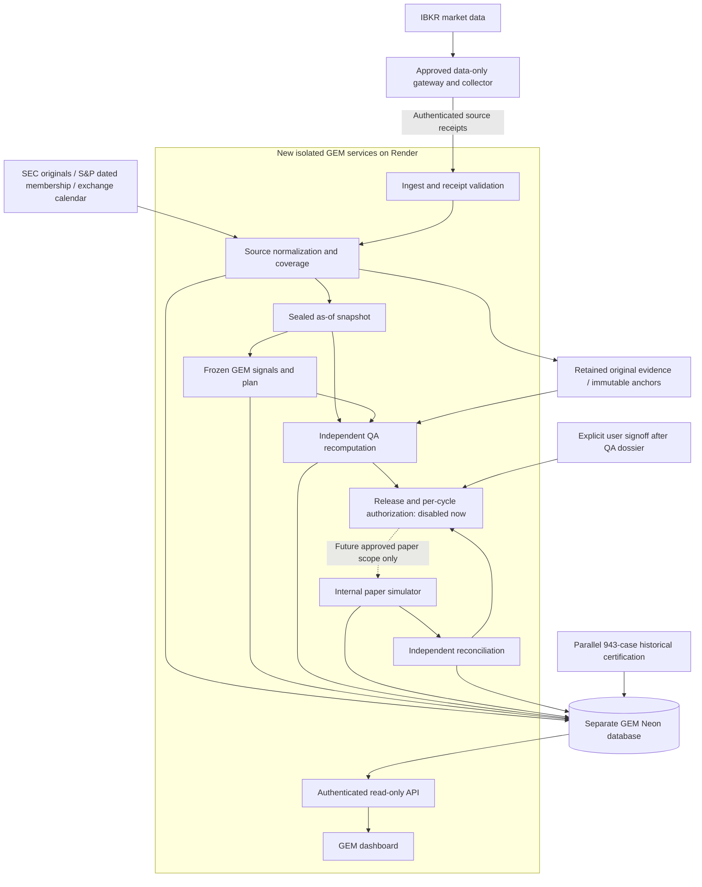

# Render, Neon and IBKR: hosting and position flow

Design clarification dated 2026-10-12. **Selected application stack: Render for the GEM dashboard/API and workers; Neon Postgres for GEM's isolated evidence metadata, workflow state and paper ledger.** The earlier in-chat interface is a local review layout. No GEM Render service, Neon project/branch, database migration, gateway session or purchase has been created or started by this change. Existing deployed services, paper portfolios and live holdings remain untouched.

## Existing resources and isolation boundary

The repository's existing Render definition supplies `DATABASE_URL` externally and remains unchanged. This public document describes future GEM components only; it does not include an account-resource inventory, workspace/service/project identifiers, deployed branch mappings, URLs, connection strings or private deployment settings. No existing service, database or portfolio is modified.

The GEM target database has not been provisioned or selected. Prefer a separate GEM-only project with an empty database, then dev/shadow branches within that project. An alternative isolated schema-only research branch requires explicitly selecting its parent project; a normal data-cloning branch must not silently bring production positions into GEM. [Neon branching guidance](https://neon.com/docs/get-started-with-neon/workflow-primer) explains isolation/schema-only options.

## Target components

| Component | Hosting / role | Boundary |
| --- | --- | --- |
| `gem-web` | New Render web service: authenticated dashboard and read-only projection API; narrowly authenticated source-ingest endpoint | Separate service, branch/build, credentials and GEM database URL. No existing app/scanner imports or broker-order capability. Browser never gets provider/database secrets. |
| `gem-data` | Render background worker: SEC/universe/calendar acquisition, IBKR receipt validation, normalization, complete coverage and sealed snapshots | Does not sign its own QA or mutate paper holdings. A missing/stale feed holds the cycle. |
| `gem-signal` | Render worker role: deterministic frozen GEM V1 selection and exact contingent/execution-observed plans | Frozen source/rule hash, whitelisted as-of inputs, no future labels and no strategy tuning. |
| `gem-qa` | Independent Render worker/service identity: raw-source recomputation, Q01–Q18 evidence and bound signed certificate | Distinct credentials and read access; cannot repair inputs, grant user release or submit a trade. Separate agent prompts alone are not this service isolation. |
| `gem-paper` | Future internal simulator worker, separate capability and Neon ledger role | Permanently absent/disabled in current prototype. Can commit only reviewed simulated events after release and current QA; cannot call an IBKR order API. |
| `gem-reconcile` | Independent worker role: journal replay, cash/shares/NAV/action reconciliation, trusted-head checks and incident evidence | No ledger edits or automatic incident clearing; failures block later authorization. |
| IBKR data bridge | Dedicated always-on machine running an approved IBKR integration and co-located market collector; see authentication below | Data-only capability, never a live order relay. It pushes signed/time-bound receipts to Render's authenticated ingest endpoint; the broker gateway is not exposed publicly. |
| Neon GEM database | Separate empty GEM database/project; dev/shadow branches, separate least-privilege reader, collector, QA and ledger roles | Proposed tables: experiments, source receipts/manifests, coverage, snapshots/candidates, signals/plans, QA/release artifacts, job leases, event journal/outbox, simulated orders/fills, cash/holdings projections, reconciliation and incidents. No production rows/credentials. |
| Evidence vault / trusted anchors | Independently retained original source bytes and signed digest checkpoints | Neon permissions/hash chains are not WORM. Qualified immutable retention, entitlement controls and restore tests remain release requirements; no object-lock guarantee is inferred from the database or generic object storage. |

Roles can share an initial worker codebase while still requiring separate process identities and credentials where independence/security demand it. The deployment/recovery tests must verify those actual controls. Neon is the durable state; Render local files are not the portfolio journal. A paid, continuously available runtime is the intended operational trial choice: [Render free services sleep after inactivity](https://render.com/docs/free), and [workers](https://render.com/docs/service-types) run continuous jobs. This is a recommendation and availability requirement, not permission to purchase a plan or deploy. Initial migrations use a reviewed direct connection; normal API traffic uses a scoped pool. No migrations are run here.

This is a target deployment diagram, not running services. There is deliberately no arrow from the paper simulator to the live Swedish ISK account.

## How Render obtains IBKR data

The user-selected chat connector `Interactive Brokers (IBKR)` already returned a successful SPY market-data sample. It demonstrates access in this conversation; it is **not** a credential, HTTP endpoint or scheduled integration that a Render process can reuse. Do not export its link/session tokens, assume an unattended API entitlement, or put a chat connector in a production data-loop design.

For an individual account, the proposed starting integration is the official TWS API through IB Gateway/TWS, with the **Read-Only API** setting enabled and a collector co-located on a dedicated always-on machine. IBKR documents that this setting [blocks API orders](https://www.interactivebrokers.com/campus/trading-lessons/installing-configuring-tws-for-the-api/). The bridge itself exposes no general broker request proxy. It accepts only contract/market-data operations, captures raw responses and their provenance, and uploads limited authenticated receipts to the GEM ingest service. It is a separate connection/bootstrap task, not something configured here. Host, account-user session compatibility, entitlement, reauthentication procedure and operational supervision remain to be qualified. A sleeping personal laptop is not assumed to provide near-production availability.

A direct Render-to-IBKR Web API integration is an alternative **only if** the user has the applicable approved authentication route. IBKR's [OAuth2 documentation](https://www.interactivebrokers.com/docs/web-api/authentication/oauth-2/introduction) describes eligibility for licensed organizations, financial advisors and IBrokers; do not assume that a retail username receives those credentials. The retail Client Portal Gateway is not an unattended-login shortcut: [IBKR's FAQ](https://www.interactivebrokers.com/docs/web-api/authentication/cpgw/client-portal-gateway-faq) states that automated authentication is unsupported and daily reauthentication is required. [Gateway limitations](https://www.interactivebrokers.com/docs/web-api/authentication/cpgw/limitations-of-the-client-portal-gateway) also require calls from the authenticated gateway machine. A co-located bridge is required for that route too. Never automate MFA bypass or silently replace it with stored passwords.

[IBKR session rules](https://www.interactivebrokers.com/docs/web-api/authentication/sessions) allow one brokerage session per username. Setup must establish a supported session arrangement that does not interrupt existing live usage. If the gateway loses authentication, returns a delay/type flag inconsistent with policy or has incomplete coverage, the bridge reports the fault, Render marks affected evidence stale, and the whole dependent cycle holds. A dashboard refresh does not log in, resume execution or convert stale data into valid observations. No connection/session changes are made during this design clarification.

Fetch security-qualified regular-session OHLCV, at least the frozen required observations, complete membership coverage, action/identity history and a separately proved observed next-open price. Verify conid/listing, currency, source/filter, bar start versus completed-session time, volume units/factors, adjustment vintages, source-observation times and correction lineage before use. In particular, one successful SPY request is not proof that all NASDAQ/NYSE securities or removed-name history are entitled/available. Financial qualification still uses original SEC evidence; index eligibility still needs dated primary membership.

## How the trial takes positions

The initial documented execution target is **GEM's internal paper simulator with USD 10,000 virtual capital**, persisted in its isolated Neon ledger. Positions are simulated GEM holdings, not purchases in the live Swedish ISK account and not orders automatically sent to an IBKR paper account.

After G1–G3 evidence, independent release review and explicit G4 user signoff, a future simulator implementation must:

1. Seal a genuinely forward month-end snapshot and independently reproduce GEM V1 eligibility/r63 rank/top-five. Unknown competitors or any Q01–Q18 failure holds the entire cycle.
2. Bind the plan to the exact account, rule/release/input hashes and reconciled starting state. At a qualified observed next-session open, reproduce five slots at 20% each, empty slots cash, whole-share floors, sell-before-buy, affordability and the frozen 20 bps per-side cost model. USD 10,000 implies approximately USD 2,000 per occupied initial slot; cost-inclusive whole-share sizing determines actual amounts.
3. Require authenticated independent QA, scoped user release, current reconciliation, trusted audit head, valid execution window, no active incident/kill switch and an unused authorization nonce. Input/plan/state changes require fresh QA. The shipped authorization function still denies unconditionally.
4. Transactionally journal intent, reserve virtual cash/shares, record capability use/idempotency keys and commit simulated fill/fee events plus resulting state. Use durable uniqueness and a fenced account owner; identical retries recover the original receipt, conflicting or uncertain outcomes hold. No real account is touched.
5. Independently replay and reconcile the ledger, then update dashboard projections. Show simulated holdings, cash, fees, distributions, NAV, turnover, drawdown and benchmark in USD; dry-run previews remain visibly separate from fills. Later SEK translations use separate timestamped FX evidence.

If the user later wants **IBKR's own paper-account fills**, that requires a separately verified IBKR paper account/environment, dedicated paper-only executor/credentials, user signoff and broker-order/reconciliation tests. Record that experiment separately from the fixed-cost canonical model: broker paper fills/pricing need not reproduce the frozen next-open execution assumptions. Do not repurpose the live data bridge or enable trading on the live account. This document does not create order instructions, reset paper-account balances, place orders or authorize that optional path.

## Concrete next implementation/release work

Complete a deployable GEM web/API and reviewed Neon schema/migrations in research branches; create no account/data copies as a shortcut. Choose and qualify the supported IBKR gateway/API host and session path, then implement the signed market-only bridge/ingest contract. Deploy a separately scoped read-only shadow service only after its concrete build/configuration and access/isolation evidence are reviewed. Exercise source loss, session expiry, queue retries, durable-write failure, restore and reconciliation before genuine G2/G3 observation. Paper purchases still require the complete QA dossier and explicit later user signoff. Existing Render services and existing Neon projects remain outside the write scope.
